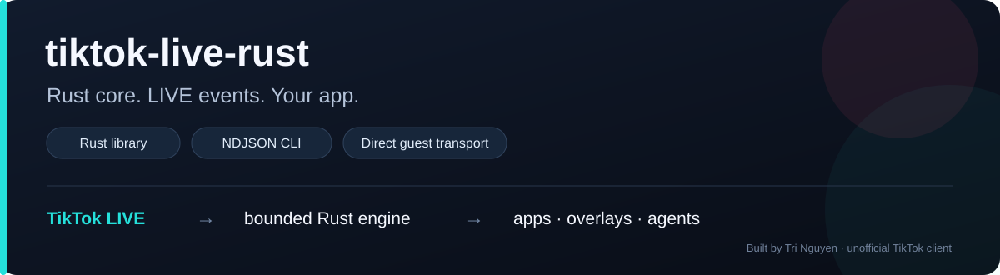

# tiktok-live-rust



[](https://github.com/thekivashyn/tiktok-live-rust/actions/workflows/ci.yml)
[](LICENSE)
[](Cargo.toml)

**TikTok LIVE → typed Rust events → JSON for your app, overlay or agent.**

A standalone Rust library and CLI that receives public LIVE events, supervises the
connection and makes delivery uncertainty visible. Embed the library in Rust, or
consume the CLI from any language that can launch a process.

Built by **[Tri Nguyen](https://github.com/thekivashyn)** · engine **0.9.0** · MIT

[Try the offline demo](#try-it-without-a-live-room) · [Connect LIVE](#connect-a-live-room) · [Integrate](#build-on-it) · [Architecture](docs/ARCHITECTURE.md) · [Agent guide](docs/AGENT_GUIDE.md)

> Unofficial TikTok client. The runtime obtains an anonymous guest identity and
> needs no account-session input, API key, signing service, Node.js or browser.
> TikTok can change or refuse this route; access and event completeness are not guaranteed.

## Why this engine exists

A live event connection is only one part of an integration. A usable engine also
needs to recover from interruptions, stay within finite resource limits and tell
the consumer when its view of the stream may be incomplete.

That is the focus here: **a supervised Rust connection, bounded state and an
explicit event contract**. UI, storage, game rules and agent actions belong to
the application built around it.

| Design choice | What your application gets |
| --- | --- |
| Direct guest transport | A local runtime without an external signing-service dependency |
| Typed Rust events + NDJSON | Native integration or a process boundary for Python and other languages |
| Backoff, cooldowns and readiness watchdogs | Recovery from transient failures with observable connection state |
| Bounded decoder, queue and per-room state | Explicit resource limits and an error when a consumer cannot keep up |
| Connection epochs and nullable gift deltas | A way to preserve uncertainty instead of inventing complete delivery/totals |
| Offline fixtures and comparative oracles | Reproducible checks independent of whether a particular creator is LIVE |

## Try it without a LIVE room

Install stable Rust with Cargo, then:

```sh
git clone https://github.com/thekivashyn/tiktok-live-rust.git
cd tiktok-live-rust
cargo run --locked --example offline_demo
```

The example feeds synthetic Protobuf bytes through the **real bounded batch
decoder and event processor**, then writes six NDJSON events. It opens no socket
and uses no real profiles or chats. Cargo may download dependencies during a first build.

| Output | What it demonstrates |
| --- | --- |
| 1 chat from `demo_creator` | A large sender ID stays a string; a duplicate input emits no second chat |
| 2 gift updates | Cumulative counts `1 → 3` become quantity deltas `1` and `2` |
| 1 like update | Per-update and cumulative counts stay distinct |
| 1 viewer snapshot | Audience count uses the same event envelope |
| 1 stream-end event | An explicit end event is represented in the output |

This demo exercises wire decoding and normalization. It does not simulate the
network supervisor. See [offline_demo.rs](examples/offline_demo.rs).

<details>
<summary>Build prerequisites</summary>

Use a current stable Rust toolchain; no minimum Rust version is claimed yet.
Windows needs the linker tools for the chosen Rust toolchain. Linux native TLS
builds need OpenSSL development headers and `pkg-config`; on Ubuntu/Debian:

```sh
sudo apt-get install pkg-config libssl-dev
```

The CI workflow checks Windows, Linux and macOS. Node.js is optional and used
only by the comparative benchmark project. Python examples require Python 3.11+.

</details>

## Connect a LIVE room

Replace `USERNAME` with a public channel that is currently LIVE:

```sh
cargo build --release --locked
cargo run --release --locked -- --user USERNAME --seconds 60 --events --status --lifecycle
```

- **stdout:** one event JSON object per line.
- **stderr:** tagged lifecycle notifications, health snapshots and the final aggregate report.
- **Ctrl+C:** cancel the session. The default duration is 60 seconds.

For an aggregate report only, omit `--events --status`. To target a known room,
use `--room ROOM_ID` instead of `--user`. An offline channel stops explicitly.

Need a longer bounded session? Add `--seconds 14400 --retry-until-deadline` for a
four-hour budget across transient outages. Backoff and Retry-After still apply;
terminal failures stop. See the [complete CLI contract](docs/USAGE.md).

## Build on it

| You are building… | Start here |
| --- | --- |
| A Rust desktop/backend application | [Rust consumer](examples/consume.rs): bounded events, reconnect lifecycle, health and cancellation |
| A Python integration | [Python consumer](examples/consume.py): concurrent pipe reads, host deadline and child cleanup |
| An agent that observes LIVE activity | [Agent integration guide](docs/AGENT_GUIDE.md): machine output, stop conditions and trust boundaries |
| An overlay, game or dashboard | Handle normalized events, then apply your own rendering, rules and storage |

### Python: a working process integration

Build the CLI and demo, then try the same consumer offline or against a LIVE room:

```sh
cargo build --release --locked --bins --example offline_demo
python examples/consume.py --demo
python examples/consume.py --user USERNAME --seconds 60
```

The example uses only Python's standard library. It drains **both output pipes**,
keeps aggregate counts, bounds input buffers and terminates its owned child on
failure or a host deadline. Extend the event handler for your application; raw
chat and profile data are not printed by default.

### Rust: embed the engine

A reproducible Git dependency for the v0.9.0 engine:

```toml
[dependencies]
tiktok-live-rust = { git = "https://github.com/thekivashyn/tiktok-live-rust", tag = "v0.9.0" }
```

Use `engine::run`, `engine::run_with_status` or `engine::run_observed` with `DirectSource`, `Config`,
`Target`, a `CancellationToken` and a bounded event channel. The complete
[consume.rs example](examples/consume.rs) runs reception, consumption and health
observation concurrently:

```sh
cargo run --locked --example consume -- USERNAME
```

The crate import is `tiktok_live_rust`. The package is not on crates.io
(`publish = false`); pin a release tag or commit and update it intentionally. There is no C ABI,
language-specific SDK or MCP server bundled with this engine.

### Reconnects your consumer can handle

**v0.9.0:** keep the same event subscription through transient reconnects, and
observe `connecting → connected → ready`, interruptions, retry waits and terminal
stops independently of application events. Rust uses `run_observed` with
`lifecycle::channel()`; CLI users add `--lifecycle` for tagged stderr records.

The lifecycle ring retains 64 notifications and explicitly reports a slow reader's
lag. A connected socket is not yet ready, and reconnecting does not recover missed
upstream events. The updated Rust/Python examples flag incomplete views rather
than silently resetting totals. [Delivery, ordering and recovery guide](docs/RECONNECTS.md).

Thanks to [@Rhytera on X](https://x.com/Rhytera) for the feedback behind this
improvement ([issue #1](https://github.com/thekivashyn/tiktok-live-rust/issues/1)).

## Events that your app can understand

Supported kinds: **chat · gift · like · follow · share · social · join · viewers · stream_end**.

A synthetic chat envelope, with optional profile metadata omitted for readability:

```json
{"sequence":1,"connection_epoch":1,"kind":"chat","room_id":"42","message_id":"101","user_id":"9007199254740993","data":{"text":"Hello from the offline demo!"}}
```

| Field | Meaning |
| --- | --- |
| `kind` + `data` | Normalized event type and typed payload |
| `user` | Optional selected sender profile; no separate profile request |
| `like_details` | Optional detailed like metadata from the same received payload |
| `sequence` | Processing order within this run |
| `connection_epoch` | Connection boundary; a change may mean source events are missing |
| `metadata_incomplete` | Optional metadata failed validation; the core event survived |

Large IDs are strings. Gift `quantity_delta: null` means **unknown**, never a
known total. Treat text and URLs as untrusted data, including when passing events
to an agent. See [USAGE.md](docs/USAGE.md) for fields, units, output counters and limits.

## Under the hood

```text
Public username / room ID
           |
TikTok lookup + anonymous guest bootstrap
           |
Verified TLS WebSocket / room entry / heartbeat / ACK
           |
Bounded gzip + Protobuf decoder
           |
Per-room normalization / dedupe / gift-combo state
           |
Bounded event channel ------> Rust consumer / NDJSON stdout

Connection supervisor -----> Coalesced health snapshots / final report
```

The engineering details are in [ARCHITECTURE.md](docs/ARCHITECTURE.md): shared
batch buffers, small-frame scheduling, joined decoder cleanup, a watchdog race
and the tradeoff between bounded gift history and exact quantity accounting.

## Evidence, with its scope attached

Current CI checks offline Rust/Python tests, source-manifest/document links,
Clippy, formatting, release builds and CLI/demo integration on three platforms.
It does not contact TikTok.

| Recorded experiment | Result | What it establishes |
| --- | --- | --- |
| 0.8.0 historical LIVE observation | 10 minutes, 990 events, zero decode errors, 3 forced recoveries | Behavior of those received samples on Windows |
| 0.7.1 matched loopback comparison | 120,218 events/s Rust vs 75,683 for Connector 2.5.0 + adapter | Median of three pairs for the specified synthetic local receive path |
| Same 0.7.1 comparison | Peak receiver working set: 6.76 MiB vs 135.70 MiB | Process memory for that workload, including the respective consumer/adapter |

The benchmark numbers belong to **0.7.1**, not a fresh 0.8.0 performance run.
Original 0.7.1 binaries/raw reports are not included in this checkout; rerunning
the harness measures the current source, rather than recreating those artifacts.
The adapter supplies equivalent application policies; these are not claims about
upstream built-ins. They do not predict TikTok latency or a universal speed/RAM
ratio. [Methodology and reproduction](benchmarks/connector/README.md) ·
[Versioned evidence](CHANGELOG.md) · [Follow-up audit](docs/SECOND_AUDIT.md).

## Boundaries to design around

- Guest access is unofficial and can change or be refused.
- Reconnects do not replay events TikTok never delivered during an outage.
- Dedupe (8,192 IDs) and gift history (4,096 keys) are finite; state is lost on restart.
- Profiles expose selected fields, not the full upstream User schema. Avatar URLs expire.
- TikTok may aggregate or omit likes; not every viewer action is observable.
- One run targets one room, with a maximum 24-hour duration budget. Finite tests
  do not prove 24/7 uptime, many-room capacity or exactly-once accounting.
- Posting comments, sending gifts, account management, storage, UI, OBS, battle and
  commerce integration are outside the current engine scope.

## Contribute a concrete improvement

Useful next work: real-world Linux/macOS LIVE observations, small integration
examples, targeted synthetic protocol regressions and longer reliability studies.
Bring a reproducible case and preserve unknown values instead of guessing them.

[Contribution guide](CONTRIBUTING.md) · [Development workflow](DEVELOPMENT.md) ·
[Report a bug](https://github.com/thekivashyn/tiktok-live-rust/issues/new/choose) ·
[Security reporting](SECURITY.md)

## License and credits

Copyright © 2026 **Tri Nguyen**. [MIT License](LICENSE).
Protocol/transport provenance and the retained upstream MIT notice are in
[THIRD_PARTY_NOTICES.md](THIRD_PARTY_NOTICES.md). Optional benchmark dependencies
retain their own licenses and are not production runtime dependencies.

Independent project; not affiliated with or endorsed by TikTok.
